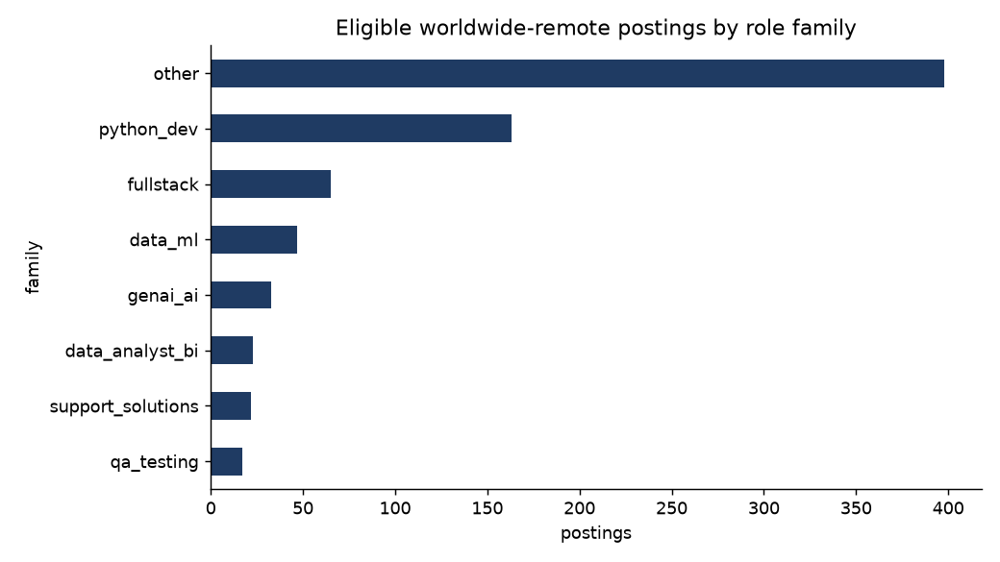

# remote-job-market-analyzer

Fetch, filter and analyze the **worldwide-remote job market** from public APIs —
then rank every posting against a resume and export an Excel dashboard with charts.

Built by [Nitesh Beniwal](https://github.com/NiteshBen01) during a real job hunt:
it answers the practical question *"of the thousands of 'remote' postings out there,
which ones can I actually take, and which fit me best?"*

**Public data sources only** (no scraping of login-walled sites): RemoteOK, Remotive,
Jobicy, Himalayas, Working Nomads, WeWorkRemotely, Arbeitnow and the monthly
Hacker News *"Ask HN: Who is hiring?"* threads.

## What it does

1. **Fetch** — pulls thousands of postings from 7 public APIs/RSS feeds in one command,
   normalizes them into a single schema and de-duplicates across sources.
2. **Filter** — a conservative location-eligibility engine decides which postings a
   candidate based in India can genuinely take. It catches the traps that simple
   "remote" filters miss: `Remote - US`, `East Coast US & Europe`, titles like
   `(EMEA - Weekends)` that narrow what the location field claims, timezone-gated
   pipelines, and country-restricted listings.
3. **Match** — scores every eligible posting against a weighted skill profile
   (Python, SQL, Pandas, Power BI, TensorFlow, CrewAI/LLM...), classifies it into a
   role family, and penalizes senior-only titles. Scores ≥ 8 are "strong matches".
4. **Store** — SQLite with `UNIQUE(url)`, so re-runs only add genuinely new postings.
5. **Report** — Excel dashboard (all eligible + strong matches) and charts:
   postings by role family, most-demanded skills, match-score distribution.

## Quick start

```bash
pip install -r requirements.txt

python cli.py fetch --db jobs.db        # fetch + filter + score (tolerates dead APIs)
python cli.py fetch --db jobs.db        # re-runs are idempotent (UNIQUE url)
python cli.py dashboard --db jobs.db --out output/
python cli.py report --db jobs.db       # headline numbers in the terminal
```

`sample_resume.md` shows the profile format the default skill weights were built for —
edit `jobmarket/match.py:DEFAULT_SKILL_WEIGHTS` to match your own skills.

## Sample output (real run, October 2026)

- 3,277 postings fetched → 2,927 after de-duplication → **780 eligible** worldwide-remote
- **218 strong matches** (score ≥ 8) across 9 role families
- Most-demanded skills in the eligible pool: `python`, `api`, `sql`, `machine learning`, `llm`

Charts from that run are in [`output/`](output/) — e.g.


## Design notes

- **Conservative eligibility beats generous.** A wrongly-included posting wastes an
  application; a wrongly-excluded one only hides a maybe. See `tests/test_pipeline.py`
  for the exact trap cases the filter must catch (13 location scenarios).
- **Skill score is capped** (12.0) so keyword-stuffed JDs can't dominate the ranking.
- **Seniority penalty (8.0/title flag)** pushes senior-only roles out of an
  entry-level candidate's apply queue, while junior/graduate titles get a bonus.
- One dead API never kills a run — each fetcher fails independently.

## Project layout

```
jobmarket/
  fetch.py         # 7 public-source fetchers + normalization + dedupe
  eligibility.py   # India-based remote eligibility rules
  match.py         # skill scoring + role-family classification
  storage.py       # SQLite + pandas analysis helpers
  dashboard.py     # matplotlib charts + Excel dashboard
cli.py             # fetch / dashboard / report commands
tests/             # pytest: eligibility traps, scoring caps, summaries
```

## License

MIT — see [LICENSE](LICENSE).
